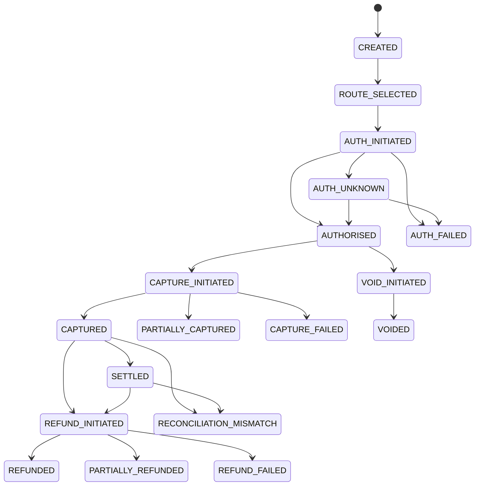

# Payment state machine

Transitions are enforced by `app/state_machine/transitions.py`; each accepted transition adds a `TransactionStateLog`. State values are persisted as strings for schema portability. This is a mock-gateway training implementation, not a PCI-certified payment platform.
